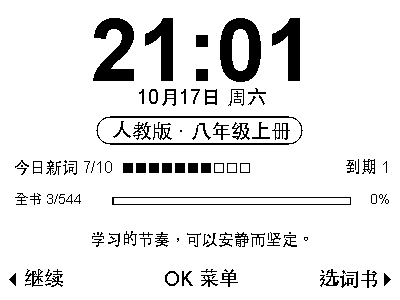

# Zectrix Word Machine · 墨水屏离线英语单词机

把 **ZECTRIX NOTE4 黑白墨水屏**变成一台可以放下手机、独立学习的英语单词机。面向新版人教初中英语和 KET / PET 备考，使用三颗实体按键完成选词书、翻卡、评分和复习。



> 实验项目，面向有 ESP32 刷机经验的个人开发者和 AI 编程智能体。代码已具备离线学习流程，基础版本已在一台黑白 NOTE4 上测试；仓库中的词库更新、分页与后续改动仍需逐项真机验收。上图是界面示意，时间和进度不是联网数据。

## 用来解决什么问题

- 按教材单元学习，把初中课内词汇和 KET/PET 词表放在同一台设备中手动切换。
- 将注意力集中在回忆、翻卡和复习，减少学习时使用手机的干扰。
- 先处理到期词，再按每天的新词目标继续学习。
- 保存词条进度、错词和收藏，学习后返回首页查看当天与当前词书的进度。

## 已有特性

- **原生 400×300、1 BPP**：纯黑白文字和点阵字形，单帧 15,000 字节。
- **大时钟首页**：日期、星期、分钟时钟、当前词书、今日新词、到期数及全书已学进度。
- **每日一句**：50条原创学习金句按日期乱序显示，同日返回或重启保持一致。
- **多词书与单元菜单**：按词书、教材单元或 KET/PET 字母组进入学习；未安装词书显示待导入。
- **翻卡和间隔复习**：忘了约10分钟、模糊约1天、记住按1/3/7/14/30/60天递进。这是可解释的原型规则，不是 FSRS。
- **全局每日目标**：5/10/15/20个新词，切换词书不重复发放额度。
- **每日统计、错词本、收藏夹**：同ID词条共享学习进度；不同义项应使用不同ID。
- **长释义分页**：阅读到答案末页后才出现评分键，避免截断完整释义。
- **会话恢复**：保留当前词、正反面、暂跳和学习记录；完整性校验失败时回退另一份快照，不自动清空。
- **本地构建与预览**：Python生成字形与词条资源，C++桌面预览复用设备模型和绘制代码。
- **备份优先的刷写工具**：首次安装和应用更新分开；更新先备份学习分区，再只写应用。

“已学”指至少评分一次，不表示已经掌握。错词/收藏队列仍遵循到期规则，不是随时提前复习模式。

## 包含的词库

本仓库包含可供本地构建的**整理后词库 JSON**，不包含原始教材 PDF、Excel、字体文件或现成固件。

| 词书 | 当前记录数 | 状态 |
| --- | ---: | --- |
| 人教七年级上册 | 329 | 用户提供词表草稿 |
| 人教七年级下册 | 465 | 用户提供词表草稿 |
| 人教八年级上册 | 554 | 用户提供词表草稿 |
| 人教八年级下册 | 511 | 用户提供词表草稿，有上游缺项待回源 |
| 人教九年级上册 | 470 | 用户提供词表草稿 |
| 人教九年级下册 | — | 待导入 |
| KET / A2 Key | 1,723 | 英文索引＋用户提供中文/音标 |
| PET / B1 Preliminary | 3,113 | 同上，DJ等未补字段保持待补状态 |

合计7,165条词书归属记录，按当前ID规则合并为5,794条记录。记录包含短语、专名和变体，不能将其解释为同样数量的全新基础单词，也不是完整考试范围认证。

**内容边界：**当前仍有67条上游缺失/粘连记录待回源；教材有437条未提供IPA，部分短语/专名没有POS。KET/PET的中文和音标来自用户提供的第三方双语表，不是剑桥官方中文释义。官方英文词表版本为所提供PDF的August 2025版，附录主题表尚未全部整合。

来源见 [data/SOURCES.json](data/SOURCES.json)。数据保留原来源权利，**代码MIT许可不覆盖词库、字体或第三方素材**；尚未确认全部数据的统一再分发/商业使用许可，请自行核实适用权限。项目不声称出版社或考试机构官方授权、背书或百分之百正确。

## 硬件与参考项目

目标硬件：**黑白 NOTE4**，ESP32-S3、16MiB Flash、8MiB Octal PSRAM、400×300 SSD2683屏、三个按键、PCF8563 RTC。不要将本固件刷入NOTE4C或未经核实的其他板型。

学习流程参考：

- [egga-word-machine-offline](https://github.com/danleegle/egga-word-machine-offline)：离线翻卡、三键自评、每日目标和到期优先的产品思路。
- ZECTRIX Lab NOTE4 ESP-IDF reference demo：本仓库实际包含其`zectrix_board`、`zectrix_epd`硬件组件，保留MIT声明。
- [Espressif ESP-IDF](https://github.com/espressif/esp-idf)及[esp_codec_dev](https://github.com/espressif/esp-adf/tree/master/components/esp_codec_dev)：运行框架和底层音频器件依赖。

本应用不依赖原厂云服务，未实现单词发音、Wi-Fi同步、OTA、口语评分。板上有相关硬件不代表应用已经实现这些功能。

## 部署：准备环境

已验证工具链：**ESP-IDF 5.5.2**，目标esp32s3。需要Python 3.10+、C++17编译器，以及ESP-IDF要求的CMake/Ninja与交叉编译器。

```sh
git clone https://github.com/happynailinzz/zectrix-word-machine.git
cd zectrix-word-machine
python3 -m venv .venv
.venv/bin/python -m pip install -r requirements.txt
```

选择具有中文、英文和IPA覆盖的本机字体，构建时明确设置：

```sh
export WORD_MACHINE_CJK_FONT=/path/to/NotoSansCJK-Regular.ttc
export WORD_MACHINE_LATIN_FONT=/path/to/DejaVuSans.ttf
```

也可以使用有相应许可的其他字体。没有字体文件或缺字时不要继续发布生成的固件。macOS部分系统字体、Linux常见Noto/DejaVu路径有回退，但建议显式指定，确保结果可复现。

## 生成资源、检查与编译

```sh
.venv/bin/python tools/audit_registered_vocab.py
.venv/bin/python tools/generate_runtime_assets.py
.venv/bin/python tools/generate_dashboard_fonts.py
./tools/check-offline.sh
.venv/bin/python -m unittest discover -s tests -v
```

生成文件在`firmware/main/generated/`，不提交Git。审计报告和预览输出在`output/`。

然后在同一终端加载自己的ESP-IDF环境：

```sh
. /path/to/esp-idf/export.sh
./tools/build-firmware.sh
```

脚本使用仓库内的硬件/音频组件，无需访问原开发者的其他目录。组件管理器默认禁用，因为所需组件已经随代码附带。**不要为解决SDK缺失而盲目跳过子模块检查**；先确保自己的ESP-IDF安装完整。

构建输出：

```text
firmware/build/zectrix_word_machine.bin
firmware/build/bootloader/bootloader.bin
firmware/build/partition_table/partition-table.bin
output/build-manifest.json
```

当前完整词库应用约1.83MiB，2MiB应用槽余量约9%；实际大小随字体和编译环境变化，以本机构建结果为准。分区表为16MiB设备配置，但没有双槽OTA。

## 刷机：先备份

使用已安装esptool的Python（通常为激活ESP-IDF后的`python`）。以下端口和MAC均为占位符，请替换为自己的值：

```sh
python -m esptool --chip esp32s3 --port /dev/YOUR_PORT flash_id
python -m esptool --chip esp32s3 --port /dev/YOUR_PORT get_security_info
```

确认黑白NOTE4、16MiB Flash、PSRAM匹配，Secure Boot和Flash Encryption未启用。工具不支持绕过安全机制。

完整备份：

```sh
python tools/device.py backup \
  --port /dev/YOUR_PORT --expected-mac aa:bb:cc:dd:ee:ff --execute
```

备份写入`.local/backups/`，附带设备信息和SHA-256，仅保留本地。该目录可能包含原厂设置，不应上传。

### 首次安装

**将替换原厂应用及初始化学习数据区。**只对有完整备份的目标设备执行：

```sh
python tools/device.py first-install \
  --port /dev/YOUR_PORT --expected-mac aa:bb:cc:dd:ee:ff \
  --backup .local/backups/full-flash-YOUR_TIMESTAMP.bin --execute
```

工具先核对备份与设备身份，再擦除新NVS/PHY及进度区，写入引导、分区表和应用。不使用整片erase_flash。原厂分区可能不同，恢复原厂需要你自己的完整备份；首次安装不是普通更新。

### 更新并保留学习数据

```sh
python tools/device.py update \
  --port /dev/YOUR_PORT --expected-mac aa:bb:cc:dd:ee:ff --execute
```

更新先读回分区表，比对一致后备份2MiB进度区，只写`0x30000`应用。**不要用first-install更新**，否则会清空学习数据。分区不一致时工具停止，不能强行将别的设备布局当作兼容。

省略`--execute`仅做本地验证，不访问串口。串口被其他程序占用时请先关闭监视器。项目不会自动选择某台机器，也不包含开发者MAC或已保存的固件备份。

## 使用方式

| 页面/操作 | 行为 |
| --- | --- |
| 首页OK短按 | 功能菜单 |
| 首页上键短按 | 继续当前学习 |
| 首页下键短按 | 选择词书，再选择单元 |
| 菜单上下键/OK | 移动/确认 |
| 卡片正面OK | 查看答案 |
| 卡片正面上键 | 管理当前词：收藏、错词、返回首页 |
| 卡片正面下键 | 暂跳 |
| 答案中间页 | 上键上一页、OK下一页、下键暂跳 |
| 答案末页 | 上键忘了、OK记住、下键模糊 |
| 任意页OK长按约0.7秒 | 返回首页，保留当前卡片 |
| 学习完成页上/下短按 | 返回首页显示实时进度 |
| 下键长按3秒 | 保存待提交状态后关机/深睡 |

短按在松开并去抖后执行；长按不会顺带评分。墨水屏操作刷新仍有等待，刷新期间按键不排队，避免旧卡评分误用于下一卡。列表移动的光标保存可延后1.5秒；评分和确认操作先提交再切页。

RTC无效时禁止评分，防止错误复习日期。首次可在`idf.py -C firmware menuconfig`的Word machine prototype中设置临近刷机的本地时间，只在RTC无效时初始化；当前没有设备校时菜单。

### 无设备预览

```sh
./tools/offline-preview.sh state
./tools/offline-preview.sh hold-ok
./tools/offline-preview.sh ok
```

命令支持`state/up/ok/down/hold-ok`，输出`output/offline-v2.pgm`，可用图片查看器打开；进度在`.local/`。它不模拟物理刷新、供电或实际NVS写入延迟。

串口诊断：

```sh
python tools/serial-diagnostics.py --port /dev/YOUR_PORT --seconds 30
```

## 自定义词库与AI开发

入口是`data/books.json`。每本书使用独立deck_id，单元最多16个，词条必须有稳定word_id。IPA/POS可空；缺中文条目必须保持待补状态，不参与认识/遗忘评分。

- 不要因为排序、修正标点或替换释义就批量重建ID。
- 同形不同义、专名与普通名词应显式区分；共享ID必须有完全一致的内容字段。
- 内容签名变化会重建当前会话，匹配ID的进度保留；退出活动词库的旧ID目前不会永久归档，应保留更新前备份。
- 教材页码不在设备显示，但可留在数据中追溯。
- 构建只读源词库；修改后重新审计、生成字形、跑测试、编译。

具体结构见[架构与词库契约](docs/architecture.md)。AI智能体先阅读[AGENTS.md](AGENTS.md)，不要隐式刷机、清空数据或把草稿标成官方认证。

## 注意事项

- 黑白NOTE4专用；真实容量、接线、供电和串口必须自行确认。
- 当前仍是实验固件，支持一次会话；答案子页码重启后从第一页开始。
- 每次评分/确认需要写快照，大词库的堆峰值、保存耗时和长期磨损需要持续实测。
- 用户环境曾出现输入异常，当前保留增加的任务栈及诊断日志；不应删除这些保护后直接声称稳定。
- 按键交互使用全刷；自动分钟时钟只在指定区域局刷，定期全刷控制残影。
- 代码可构建不代表词库完整、音标正确、例句适龄、长期续航或物理掉电全部通过。
- 项目不内置API密钥、设备身份、Wi-Fi凭据、个人路径或现成固件；上传日志前也应检查设备信息。

## 下一步优化方向

1. **内容审校**：补67条源缺项，审核IPA/POS、同形义项、KET/PET常用释义，并导入九下。
2. **进度与存储**：为退役词条归档，追加评分日志替代频繁全快照，完善跨版本迁移与导出。
3. **交互与性能**：测量按键到显示延迟、堆峰值、掉电恢复和长时间写入，改善长释义分页体验。
4. **离线音频**：资源按词书安装，先做单词发音和听音辨词，再做录音回放。
5. **资源与升级**：词库/字库/音频与应用分离，规划双槽OTA及内容包原子更新。
6. **练习模式**：词形变化、三键拼写补全、例句与独立技能进度。
7. **可选联网**：Wi-Fi配网、事件级进度同步，后续再评估跟读评分服务。

## 许可

项目原创代码使用[MIT License](LICENSE)。第三方组件和数据的范围见[THIRD_PARTY_NOTICES.md](THIRD_PARTY_NOTICES.md)。词库数据和字体不自动继承代码许可。欢迎提交修复、内容问题和真机测试结果，报告中请注明固件版本、板型及复现步骤，并移除个人和设备敏感信息。
